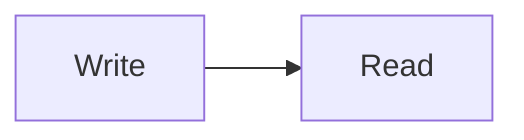

# Markdown syntax in md

md follows GitHub-flavoured Markdown and adds a few common extensions. Each example below shows the source. Math, diagrams and code highlighting load only when a document uses them.

## Text

| Write | Get |
| --- | --- |
| `**bold**` | bold |
| `*italic*` or `_italic_` | italic |
| `~~struck~~` | strikethrough |
| `==marked==` | highlighted text |
| `H~2~O` | subscript |
| `x^2^` | superscript |
| `` `code` `` | inline code |
| `:tada:` | an emoji, from a small built-in set |

A line ending in two spaces or a backslash breaks the line. A blank line starts a new paragraph.

## Headings and the contents list

```markdown
# Heading 1
## Heading 2
### Heading 3

[[toc]]
```

Each heading gets an anchor you can link to. `[[toc]]` draws a contents list of the headings in the document.

## Lists and tasks

```markdown
- a bullet
  - nested
1. a number
2. the next

- [x] a finished task
- [ ] an open one
```

Task boxes can be clicked in the preview, and the source follows.

## Links, pictures and autolinks

```markdown
[a link](https://example.com)
<https://example.com>
https://example.com

```

Web pictures are never fetched. A picture whose address is on the web shows as a chip with the host name; clicking it opens the picture in a new tab. Pictures given as `data:` addresses show in place. A picture you paste or drop is stored at the end of the document, as `![name][img-1]` with its definition below, so the file stays one portable file.

## Tables

```markdown
| Left | Centre | Right |
| :--- | :----: | ----: |
| a    |   b    |     c |
```

## Quotes and alerts

```markdown
> A quote.

> [!NOTE]
> Useful context.

> [!WARNING]
> Something to watch.
```

The alert kinds are `NOTE`, `TIP`, `IMPORTANT`, `WARNING` and `CAUTION`.

## Code

````markdown
```go
fmt.Println("highlighted by language")
```
````

Fenced code is highlighted by its language name. Each code block has a copy button.

## Math

```markdown
Inline: $e^{i\pi} + 1 = 0$

$$
\int_0^1 x^2 \, dx = \tfrac{1}{3}
$$
```

`$…$` and `\(…\)` are inline. `$$…$$`, `\[…\]` and `\begin{…}` blocks are displayed. Math is set with KaTeX.

## Diagrams

````markdown

````

Diagrams are drawn by Mermaid in its strict mode. A diagram with an error shows the error and its source.

## Footnotes

```markdown
A claim.[^1]

[^1]: The source.
```

## Collapsible sections

```markdown
<details>
<summary>Show more</summary>

Hidden text.

</details>
```

Only a safe set of HTML tags survives. Scripts, forms, frames, media and `style` attributes are removed before anything is drawn.

## Front matter

```markdown
---
title: A document
tags: [notes, draft]
---
```

Front matter at the top of the file is shown as a quiet table of keys and values above the text.
