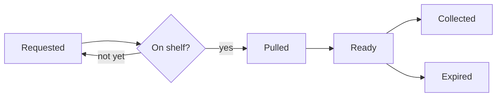

# A tour of md

> **This page is also a tour.** Each **Try it.** names one thing to click or press, next to what it works on. This copy is yours: change anything.

You run the volunteer desk at the Elm Street Library. This week you are planning how hold requests will work, from home, with nothing but this page. It is a small plan with every kind of thing md can draw.

> **Try it.** Click Properties above the title to see the front matter.

> **Try it.** In Page view, click any sentence and type.

## The idea

A hold is a **promise**: the book is *yours* until Friday. People find it easier to trust a ==marked== date than a long reply. If you need an exact word, put it in `code`. The desk kettle boils H~2~O. The full policy is on the [library website](https://example.com/policy), and the short link is https://example.com/holds.

> **Try it.** Open Settings and choose Typeface: Literata or Newsreader. Each loads the first time you choose it.

> **Try it.** The A at the bottom right, or ⌥⌘= and ⌥⌘−, changes the text size. Click the percentage for 100%. On a phone it is in Settings.

## Opening hours

| Day       | Opens | Closes |
|:----------|------:|-------:|
| Monday    | 10:00 | 18:00  |
| Wednesday | 10:00 | 20:00  |
| Saturday  | 09:00 | 13:00  |

> **Try it.** Press ⌘\ to see the table as Markdown. Keep pressing to step through Split and Read and back to Page.

## Before launch

- [x] Write the one-page rules
- [ ] Print the shelf labels
- [ ] Ask Ravi to test the form[^1]

> [!WARNING]
> Members' email addresses are private. Keep them out of every sheet you share.

[^1]: Ravi has the old phone, which is the slowest one we have. That is the point.

> **Try it.** Tick a box: the Markdown changes with it.

> **Try it.** Click the small number by "form", then ↩.

## Late fees

A late book costs a quarter a day, and never more than five dollars:

$$
\text{fee} = \min(0.25\,d,\ 5)
$$

> **Try it.** Click the formula in Page view: it opens as TeX, drawn as you type.

## The request

This is what the form sends to the desk:

```json
{
  "member": "E-2041",
  "title": "The Overstory",
  "pickup": "Elm Street desk",
  "hold_days": 7
}
```

> **Try it.** Hover the block and press copy.

## How a hold moves



> **Try it.** Hover the diagram: Zoom fills the window, and the download button saves PNG, JPEG, WEBP or SVG. WEBP keeps the clear background.

## Who talks to whom

```plantuml
Member -> Website : asks for a hold
Website -> Catalogue : is it on the shelf?
Catalogue --> Website : yes
Website -> Desk : pull this book
Desk -> Mail : tell the member
Mail --> Member : your hold is ready
```

> **Try it.** Hover the diagram and press Copy image, then paste it into a message.

## The system in context

```plantuml
!include <C4/C4_Context>
Person(member, "Member", "Asks for a hold")
System(site, "Hold desk", "Takes requests, tells the desk")
System_Ext(catalogue, "Catalogue", "What is on the shelf")
System_Ext(mail, "Mail", "Sends the notice")
Rel(member, site, "Asks")
Rel(site, catalogue, "Checks")
Rel(site, mail, "Sends the notice through")
```

> **Try it.** Switch to dark with the moon at the top right: the diagram above is drawn again for it. The C4 boxes keep their own colours.

## The desk

```drawio
<mxGraphModel>
  <root>
    <mxCell id="0"/>
    <mxCell id="1" parent="0"/>
    <mxCell id="2" value="Volunteer" style="rounded=1;whiteSpace=wrap;fillColor=#dae8fc;strokeColor=#6c8ebf;" vertex="1" parent="1">
      <mxGeometry x="20" y="40" width="110" height="50" as="geometry"/>
    </mxCell>
    <mxCell id="3" value="Shelf" style="rounded=1;whiteSpace=wrap;fillColor=#fff2cc;strokeColor=#d6b656;" vertex="1" parent="1">
      <mxGeometry x="190" y="40" width="110" height="50" as="geometry"/>
    </mxCell>
    <mxCell id="4" value="Member" style="rounded=1;whiteSpace=wrap;fillColor=#d5e8d4;strokeColor=#82b366;" vertex="1" parent="1">
      <mxGeometry x="360" y="40" width="110" height="50" as="geometry"/>
    </mxCell>
    <mxCell id="5" style="endArrow=classic;html=1;" edge="1" parent="1" source="2" target="3">
      <mxGeometry relative="1" as="geometry"/>
    </mxCell>
    <mxCell id="6" style="endArrow=classic;html=1;" edge="1" parent="1" source="3" target="4">
      <mxGeometry relative="1" as="geometry"/>
    </mxCell>
  </root>
</mxGraphModel>
```

> **Try it.** Hover the drawing and download it as SVG. draw.io drawings stay light, on their own card.

## The poster


> **Try it.** Hover the picture and download it as PNG at 2×.

## Writing on the page

> **Try it.** With nothing open, press H2 in the bar at the top: a heading starts at the end. Esc finishes.

> **Try it.** Type / on an empty line for blocks.

## Find and replace

The shelf is cleared every 10 min in the lunch rush. A pulled book waits at the desk for 15 min.

> **Try it.** Replacing needs the Markdown in view, so press ⌘\ first. Then press ⌘F, search for `10 min`, choose Replace, type `10 minutes` and press Replace. All changes every match at once, and one undo takes them back. In md Local, the .* button turns on patterns such as `(\d+) min`.

## Finding your way

This page is long on purpose, so there is somewhere to go.

> **Try it.** Hover the ticks on the right edge, or press ⇧⌘O.

> **Try it.** Open Info (ⓘ) in the dock and click Diagrams to jump to the first one.

## Make it yours

> **Try it.** In Settings, choose Colours: Paper, then the moon for its cocoa night. Calm is a deeper sepia, with a quiet dark.

> **Try it.** In Settings, choose Page width: Narrow, Normal, Wide.

## Share it

> **Try it.** Press ⌘P, or Export, Download PDF, then Save as PDF. Pages are numbered and diagrams print light.

> **Try it.** Export, Download HTML: one file that opens anywhere.

## Nothing leaves

Everything above was drawn on this device. Typefaces and diagram engines came from md's own site when you first needed them; your words never went the other way.

> **Try it.** Open the shield and press Try to break out. Every attempt is refused, one of them from inside a diagram engine.

## md Local

md Local opens files on your Mac. An agent runs `md notes.md` and the file appears as a tab; ⌘S writes the file itself. Show in Finder, at the bottom left, opens Finder with the file selected. A web page can't do that, because browsers never tell it where a file is.

> **Try it,** in md Local. Click Show in Finder.
